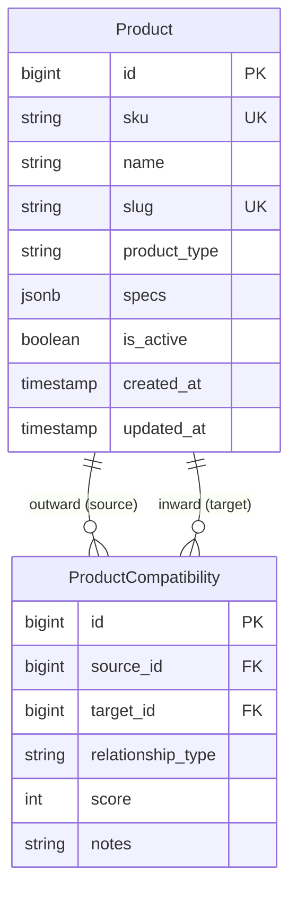

# Data Model: Grafo Relacional de Catálogo y Compatibilidades (Fase 3)

**Feature**: `002-catalog-graph-architecture`  
**Date**: 2026-10-19  
**Status**: Ready  

---

## 1. Entidad: Producto (`Product`)

Representa un nodo físico en el catálogo eléctrico (un tablero, un interruptor termomagnético, un módulo diferencial o un accesorio).

### Definición de Campos

| Campo | Tipo Django / SQL | Null / Blank | Default | Descripción y Reglas de Validación |
|-------|-------------------|--------------|---------|-----------------------------------|
| `id` | `BigAutoField` | No | Auto | Clave primaria |
| `sku` | `CharField(max_length=64)` | No | - | Código único de producto / número de parte del fabricante. `unique=True`, `db_index=True`. |
| `name` | `CharField(max_length=255)` | No | - | Nombre descriptivo comercial y técnico del producto. |
| `slug` | `SlugField(max_length=255)` | No | - | Identificador amigable para URLs. `unique=True`. |
| `product_type` | `CharField(max_length=20)` | No | - | Tipo de nodo según `ProductType`. `db_index=True`. |
| `description` | `TextField` | Sí | `""` | Descripción técnica detallada o notas comerciales. |
| `specs` | `JSONField` | Sí | `dict` | Atributos técnicos flexibles (polos, amperaje, voltaje, montaje, dimensiones, material). |
| `is_active` | `BooleanField` | No | `True` | Estado de disponibilidad en el cotizador. `db_index=True`. |
| `created_at` | `DateTimeField` | No | `auto_now_add` | Fecha de creación del registro en UTC. |
| `updated_at` | `DateTimeField` | No | `auto_now` | Fecha de última modificación en UTC. |

### Enumeraciones: `ProductType`
```python
class ProductType(models.TextChoices):
    BOARD = "BOARD", "Tablero / Gabinete"
    COMPONENT = "COMPONENT", "Componente Principal (Interruptor, Módulo)"
    ACCESSORY = "ACCESSORY", "Accesorio / Complemento"
```

---

## 2. Entidad: Compatibilidad de Producto (`ProductCompatibility`)

Representa una arista dirigida en el grafo de catálogo que conecta un producto anfitrión/contenedor (`source`) con un producto instalado o complementario (`target`).

### Definición de Campos

| Campo | Tipo Django / SQL | Null / Blank | Default | Descripción y Reglas de Validación |
|-------|-------------------|--------------|---------|-----------------------------------|
| `id` | `BigAutoField` | No | Auto | Clave primaria |
| `source_id` | `ForeignKey(Product)` | No | - | Producto anfitrión / contenedor (`on_delete=models.CASCADE`, `related_name="outward_compatibilities"`). |
| `target_id` | `ForeignKey(Product)` | No | - | Producto componente / accesorio a instalar (`on_delete=models.CASCADE`, `related_name="inward_compatibilities"`). |
| `relationship_type` | `CharField(max_length=30)` | No | `COMPATIBLE_WITH` | Semántica técnica de la arista según `RelationshipType`. `db_index=True`. |
| `score` | `PositiveIntegerField` | No | `100` | Puntuación de prioridad de recomendación (mayor puntuación = mayor preferencia en cotización). |
| `notes` | `CharField(max_length=255)` | Sí | `""` | Notas técnicas de montaje (ej. "Montaje lateral izquierdo", "Requiere kit de montaje"). |

### Enumeraciones: `RelationshipType`
```python
class RelationshipType(models.TextChoices):
    COMPATIBLE_WITH = "COMPATIBLE_WITH", "Compatible dentro de (Montaje principal)"
    COMPLEMENT_OF = "COMPLEMENT_OF", "Complemento o Accesorio de"
    REQUIRES = "REQUIRES", "Requiere obligatoriamente"
    ALTERNATIVE_TO = "ALTERNATIVE_TO", "Alternativa / Reemplazo directo"
```

---

## 3. Restricciones e Índices de Base de Datos

### Restricciones de Integridad (`Constraints`)
1. **Unicidad de Arista (`UniqueConstraint`)**:
   - `fields = ["source", "target", "relationship_type"]`
   - `name = "unique_source_target_rel_type"`
   - *Objetivo*: Impide crear aristas duplicadas con el mismo tipo de relación entre los mismos dos productos.
2. **Prevención de Auto-relación (`CheckConstraint`)**:
   - `check = ~models.Q(source=models.F("target"))`
   - `name = "prevent_self_relation"`
   - *Objetivo*: Garantiza que un producto no pueda asociarse consigo mismo a nivel de motor de base de datos.

### Índices de Alto Rendimiento (`Indexes`)
1. **Índice B-Tree Compuesto Origen (`source_rel_type_idx`)**:
   - `fields = ["source", "relationship_type"]`
   - *Propósito*: Optimiza la consulta directa "¿Qué componentes o accesorios caben en este producto `source`?".
2. **Índice B-Tree Compuesto Destino (`target_rel_type_idx`)**:
   - `fields = ["target", "relationship_type"]`
   - *Propósito*: Optimiza la consulta inversa "¿En qué tableros o interruptores puedo instalar este accesorio `target`?".

---

## 4. Diagrama Entidad-Relación y Estructura del Grafo



### Reglas de Negocio y Transiciones
1. **Dirección Canónica**:
   - En `COMPATIBLE_WITH`: `source` = Tablero/Gabinete, `target` = Interruptor/Componente.
   - En `COMPLEMENT_OF`: `source` = Componente o Tablero, `target` = Accesorio.
   - En `REQUIRES`: `source` = Componente que tiene la dependencia, `target` = Elemento indispensable.
   - En `ALTERNATIVE_TO`: `source` = Producto base, `target` = Sustituto equivalente.
2. **Filtrado Activo**:
   - Ninguna consulta del cotizador debe incluir productos con `is_active = False`, independientemente de que existan aristas históricas en la base de datos.
