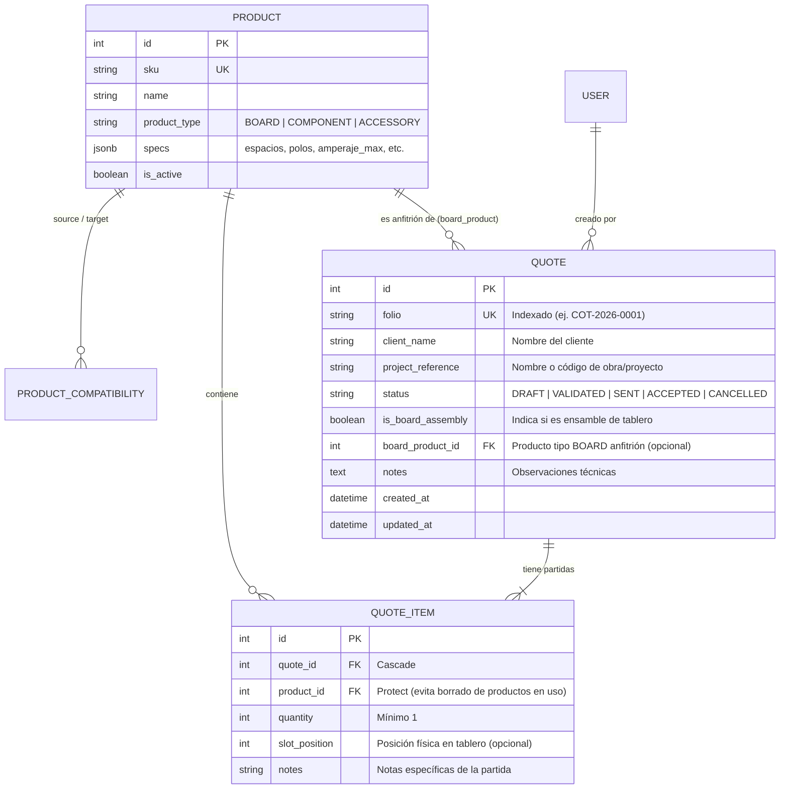
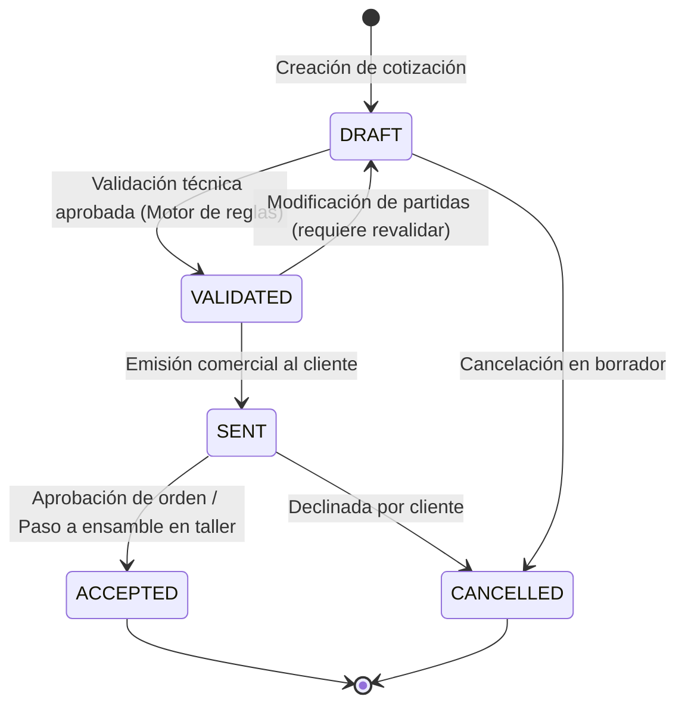

# Data Model: Flujo Principal de Configuración y Cotizaciones Técnicas (Fase 4 - Happy Path)

Este documento define el modelo de entidades relacionales, restricciones de integridad y transiciones de estado para la aplicación `src/quotes/`.

---

## 1. Diagrama Entidad-Relación



---

## 2. Definición Detallada de Entidades

### 2.1 `QuoteStatus` (Enumeración de Dominio)

```python
class QuoteStatus(models.TextChoices):
    DRAFT = "DRAFT", "Borrador (Editable)"
    VALIDATED = "VALIDATED", "Validada Técnicamente"
    SENT = "SENT", "Emitida al Cliente (Solo Lectura)"
    ACCEPTED = "ACCEPTED", "Aceptada / En Taller (Solo Lectura)"
    CANCELLED = "CANCELLED", "Cancelada (Solo Lectura)"
```

### 2.2 `Quote` (Cotización / Configuración Técnica)

| Campo | Tipo Django | Restricciones / Opciones | Descripción |
| :--- | :--- | :--- | :--- |
| `id` | `BigAutoField` | PK | Identificador interno único |
| `folio` | `CharField(32)` | `unique=True`, `db_index=True` | Folio correlativo anual (ej. `COT-2026-0001`) |
| `client_name` | `CharField(255)` | `blank=False` | Nombre o razón social del cliente |
| `project_reference` | `CharField(255)` | `blank=True`, `default=""` | Referencia o identificador del proyecto/obra |
| `status` | `CharField(20)` | `choices=QuoteStatus.choices`, `default=DRAFT`, `db_index=True` | Estado actual en el ciclo de vida |
| `is_board_assembly` | `BooleanField` | `default=False`, `db_index=True` | Bandera que activa validaciones de capacidad física de tablero |
| `board_product` | `ForeignKey(Product)` | `null=True`, `blank=True`, `on_delete=SET_NULL`, `related_name="board_quotes"` | Tablero/gabinete contenedor si `is_board_assembly=True` |
| `created_by` | `ForeignKey(User)` | `null=True`, `blank=True`, `on_delete=SET_NULL` | Usuario que registró la cotización |
| `notes` | `TextField` | `blank=True`, `default=""` | Notas generales o requerimientos especiales |
| `created_at` | `DateTimeField` | `auto_now_add=True` | Fecha y hora de creación |
| `updated_at` | `DateTimeField` | `auto_now=True` | Fecha y hora de última modificación |

#### Reglas de Negocio en Modelo:
- Si `is_board_assembly = True`, el campo `board_product` debe ser obligatorio y su `product_type` debe ser obligatoriamente `ProductType.BOARD`.
- Métodos auxiliares: `can_edit()`, `is_validated()`.

### 2.3 `QuoteItem` (Partida de Cotización / Ensamble)

| Campo | Tipo Django | Restricciones / Opciones | Descripción |
| :--- | :--- | :--- | :--- |
| `id` | `BigAutoField` | PK | Identificador interno de partida |
| `quote` | `ForeignKey(Quote)` | `on_delete=CASCADE`, `related_name="items"` | Cotización a la que pertenece |
| `product` | `ForeignKey(Product)` | `on_delete=PROTECT`, `related_name="quote_items"` | Producto del catálogo seleccionado |
| `quantity` | `PositiveIntegerField` | `default=1`, `validators=[MinValueValidator(1)]` | Número de piezas requeridas |
| `slot_position` | `PositiveIntegerField` | `null=True`, `blank=True` | Número de ranura o polo físico de montaje en el tablero |
| `notes` | `CharField(255)` | `blank=True`, `default=""` | Notas de montaje o derivación |

#### Restricciones de Base de Datos (`Meta.constraints`):
- `UniqueConstraint(fields=["quote", "product", "slot_position"], name="unique_quote_product_slot")`: Evita duplicar el mismo producto en la misma posición de ranura dentro de una misma cotización.

---

## 3. Máquina de Estados y Reglas de Transición



### Reglas de Mutabilidad:
1. **Estados Editables**: `DRAFT` y `VALIDATED`.
   - Modificar una cotización en estado `VALIDATED` devuelve su estado automáticamente a `DRAFT` para exigir re-evaluación antes de emitirse.
2. **Estados Inmutables (Solo Lectura)**: `SENT`, `ACCEPTED`, `CANCELLED`.
   - Cualquier intento de `add_item`, `update_item` o `delete_item` lanza una excepción de negocio `QuoteStateError` y es rechazado con HTTP 409 Conflict.
