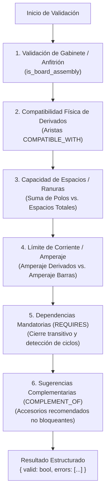

# Research & Architectural Decisions: Flujo Principal de Configuración, Validación Eléctrica y Cotizaciones Técnicas (Fase 4 - Happy Path)

Este documento consolida las decisiones de diseño arquitectónico y técnico para la implementación del Core Happy Path de CPQ técnico en **ABV ELECTRIC SUPPLY**.

---

## 1. Modelo de Cotizaciones Técnicas (`Quote` y `QuoteItem`) sin Precios

### Decisión
Modelar las cotizaciones en una nueva aplicación Django `src/quotes/` con entidades `Quote` y `QuoteItem` enfocadas exclusivamente en la configuración técnica, trazabilidad y estado, **sin ningún campo de precio monetario, divisa, descuento financiero ni impuestos (IVA)**.

### Justificación
- La directriz de negocio confirmada por el usuario establece que la base de datos no debe gestionar precios en esta fase.
- El sistema resuelve el problema nuclear de ingeniería: compatibilidad de partes, capacidad física en tableros y despiece exacto de materiales (BOM).
- Se preserva el principio YAGNI (You Aren't Gonna Need It) evitando campos ficticios con ceros o nulos que ensuciarían el dominio.

### Alternativas Evaluadas
- *Incluir `base_price` y `unit_price` opcionales en cero o nulos*: Descartado porque introduce confusión semántica en las cotizaciones y sugiere cálculos financieros que no aplican a la operación actual del sistema.
- *Guardar cotizaciones como un JSON sin esquema en PostgreSQL*: Descartado porque impide restricciones de integridad relacional, búsquedas indexadas y auditoría de cambios en Django Admin.

---

## 2. Motor de Validación Técnica de Reglas Eléctricas y Manejo de `REQUIRES`

### Decisión
Implementar un motor de validación desacoplado en `src/quotes/rules.py` que opera como un pipeline determinista en memoria sobre las partidas de la cotización y el grafo de compatibilidad:



### Tratamiento de Dependencias Obligatorias (`REQUIRES`) y Ciclos
- **Cierre transitivo**: Si el producto $A$ `REQUIRES` $B$, y $B$ `REQUIRES` $C$, el motor valida que tanto $B$ como $C$ estén presentes en las cantidades requeridas en la cotización.
- **Prevención de ciclos**: Se utiliza un algoritmo de recorrido por grafos (DFS) con un conjunto de nodos visitados en la rama de recursión (`recursion_stack`). Si se detecta un ciclo mutuo ($A$ requiere $B$ y $B$ requiere $A$), el motor valida que ambos estén presentes en la cotización y no entra en recursión infinita.
- **`COMPLEMENT_OF` vs `REQUIRES`**: `COMPLEMENT_OF` se trata estrictamente como una sugerencia comercial (*cross-selling*); su ausencia jamás invalida la cotización. Solo `REQUIRES` genera un error de bloqueo (`MISSING_REQUIRED_ACCESSORY`).

### Estructura de Respuesta de Validación
El motor emite contratos tipados estructurados:
```json
{
  "valid": false,
  "errors": [
    {
      "code": "INSUFFICIENT_SPACE",
      "message": "La configuración excede los espacios disponibles en el tablero.",
      "details": {
        "required_spaces": 32,
        "available_spaces": 30,
        "overflow": 2
      }
    },
    {
      "code": "MISSING_REQUIRED_ACCESSORY",
      "message": "El componente INT-QO-120 requiere un accesorio obligatorio que no ha sido agregado.",
      "details": {
        "source_sku": "INT-QO-120",
        "required_target_sku": "ACC-AUX-QO"
      }
    }
  ]
}
```

---

## 3. Integración Tecnológica de Interfaces (Django Templates + Tailwind + Alpine.js / HTMX)

### Decisión
Construir las dos interfaces web directamente integradas en el proyecto Django mediante:
1. **Django Templates**: Estructura base HTML, layout unificado y renderizado del servidor con contexto autenticado.
2. **Tailwind CSS**: Estilizado moderno, responsivo y coherente con la identidad visual corporativa de ABV Electric Supply.
3. **Alpine.js**: Reactividad ligera en el cliente para interacciones locales inmediatas (filtrado de productos, conteo visual provisional de ranuras, sliders de cantidad y apertura de paneles de accesorios).
4. **HTMX**: Comunicación asíncrona parcial con el backend (peticiones `hx-post` a endpoints de validación y refresco atómico de la barra de ocupación y alertas sin recargar la página completa).

### Justificación
- No requiere configurar entornos complejos de empaquetado Node.js/Vite en producción en el VPS.
- Garantiza que la autoridad final de la validación siempre permanezca en el servidor Django.
- Máxima velocidad de desarrollo y simplicidad operativa.

---

## 4. Generación y Consistencia de la Lista de Materiales (BOM)

### Decisión
El despiece técnico (*Bill of Materials* - BOM) se calculará mediante el selector `get_quote_bom(quote_id)`.
- **Estructura del BOM**:
  - Encabezado: Folio de cotización, cliente, referencia de proyecto, tablero anfitrión, estado y fecha.
  - Partidas agrupadas por categoría: Gabinete/Tablero base, Componentes derivados (interruptores) y Accesorios/Complementos.
  - Columnas: SKU, Nombre oficial, Tipo de producto, Cantidad total requerida, Posición/Ranura asignada y Notas de montaje.
- **Inmutabilidad y congelamiento**: Cuando una cotización se valida o se emite (`SENT` o `ACCEPTED`), la lista de materiales queda protegida contra mutaciones para asegurar que taller ensamble exactamente lo dictaminado.
